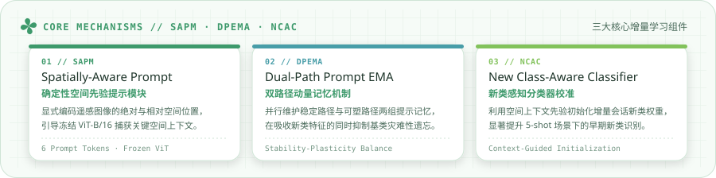

<p align="center">
  <picture>
    <source media="(prefers-color-scheme: dark)" srcset="docs/cards/terrasap-hero-dark.svg">
    
  </picture>
</p>

<p align="center">
  <a href="https://doi.org/10.1109/JSTARS.2025.3644602"></a>
  <a href="docs/protocol.md"></a>
  <a href="docs/implementation.md"></a>
  <a href="docs/datasets.md"></a>
</p>

**TerraSAP** (*Spatially Aware Prompt-Based Framework for Few-Shot Class-Incremental Learning in Remote Sensing Image Classification*) combines spatially aware prompts (**SAPM**), dual-path prompt EMA memories (**DPEMA**), and a new class-aware classifier (**NCAC**) on a frozen `ViT-B/16` backbone. This repository contains research code, experiment configurations, dataset preparation scripts, and reference split inventories. Datasets and trained checkpoints are not included.

<p align="center">
  <picture>
    <source media="(prefers-color-scheme: dark)" srcset="docs/cards/terrasap-arch-dark.svg">
    
  </picture>
</p>

---

## Setup

Use Python 3.9 or newer. Install PyTorch and torchvision appropriate for your CUDA environment, then:

```bash
pip install -r requirements.txt
```

For hyperspectral/So2Sat preparation, also install `requirements-preparation.txt`. Dependency versions and the historical pretrained checkpoint have not been locked; see the [implementation notes](docs/implementation.md) for validation scope.

## Data

Prepare ImageFolder-style `train/<class_name>/` and `test/<class_name>/` directories beneath each dataset folder:

| Dataset | Folder under `data/` | Config |
| :--- | :--- | :--- |
| **NWPU-RESISC45** | `NWPU-RESISC45` | `configs/nwpu.json` |
| **UCM** | `UCMerced_LandUse_processed` | `configs/ucm.json` |
| **MSTAR** | `MSTAR` | `configs/mstar.json` |
| **SIRI-WHU** | `SIRI-WHU` | `exps/simplified_ablation/siri_whu_full_system.json` |
| **So2Sat-LCZ42** | `So2Sat-LCZ42_ImageFolder` | `exps/simplified_ablation/so2sat_full_system.json` |
| **Pavia University** | `PaviaU_ImageFolder` | `exps/simplified_ablation/paviau_full_system.json` |
| **Houston 2013** | `GRSS2013_ImageFolder` | `exps/simplified_ablation/grss2013_full_system.json` |

Set `data_root` in a config to change the common parent directory. [Split inventories](splits/README.md) cover NWPU, UCM, and MSTAR; they are reference lists, not automatic dataset downloads or enforced manifests.

Preparation commands and extension-protocol caveats are in [Dataset preparation](docs/datasets.md). Use fresh output directories:

```bash
python scripts/prepare_paviau.py --src data/PaviaU --dst data/PaviaU_ImageFolder
python scripts/prepare_grss2013.py --src data/GRSS2013 --dst data/GRSS2013_ImageFolder
python scripts/prepare_so2sat.py --src data/So2Sat-LCZ42 --dst data/So2Sat-LCZ42_ImageFolder
```

## Run

1. In `configs/*.json`, set `pretrained_model_name` to a verified timm `ViT-B/16` checkpoint identifier. The paper specifies ImageNet-21k pretraining; record the chosen identifier, timm version, and weight hash. A `null` value stops execution instead of choosing weights silently.
2. Adjust `device` (`["0"]` for a GPU or `["-1"]` for CPU), `seed`, and `data_root`.
3. Run from the repository root:

   ```bash
   python main.py --config configs/nwpu.json
   python main.py --config configs/ucm.json
   python main.py --config configs/mstar.json
   ```

These three presets use 40 base epochs, SGD at 0.007, batch size 16, six prompt tokens, and fixed 5-shot incremental supports. The `paper_protocol` option selects the common crop/flip transforms. Training retains final-epoch base weights; automatic checkpoint reuse requires `resume: true`. Logs include the selected support paths.

[Legacy ablation and extension configs](exps/simplified_ablation/README.md) retain their budgets and augmentation options. Configs without `pretrained_model_name` use the legacy timm default with a warning; this does not identify the paper's weights. Explicit checkpoint selection applies to both spatial and baseline prompt encoders.

## Checks

```bash
python -B -m unittest discover -s tests -v
```

The dependency-free suite checks configurations, split inventories, sampling, metrics, syntax, and selected contracts with mocks. It does not import or run the full model. Full training, timm compatibility, and GPU numerical validation remain untested.

## Citation and acknowledgement

Please cite the [published TerraSAP paper](https://doi.org/10.1109/JSTARS.2025.3644602), *IEEE Journal of Selected Topics in Applied Earth Observations and Remote Sensing*, vol. 19, pp. 3143–3156, 2026:

```bibtex
@article{terrasap2026jstars,
  title   = {TerraSAP: Spatially Aware Prompt-Based Framework for Few-Shot Class-Incremental Learning in Remote Sensing Image Classification},
  journal = {IEEE Journal of Selected Topics in Applied Earth Observations and Remote Sensing},
  volume  = {19},
  pages   = {3143--3156},
  year    = {2026},
  doi     = {10.1109/JSTARS.2025.3644602}
}
```

This work builds on [ASP (ECCV 2024)](https://github.com/DawnLIU35/FSCIL-ASP). Upstream attribution is retained in the source. Obtain datasets and pretrained weights from their respective providers. No separate open-source license grant is supplied here; redistribution requires checking the applicable upstream and contributor permissions.
